# Laporan Praktikum 7: Pemrograman Server-Side dengan PHP

Repositori ini dibuat untuk memenuhi tugas mata kuliah Pemrograman Web - Praktikum 7 yang berfokus pada implementasi pemrograman server-side menggunakan PHP, mulai dari sintaks dasar, variabel, struktur kontrol, function, hingga pemrosesan serta validasi form HTML dengan metode GET dan POST.

## Identitas Mahasiswa
* *Nama:* Berliansa
* *NIM:* 312510324
* *Mata Kuliah:* Pemrograman Web

---

## Perangkat dan Cara Menjalankan Server Lokal
* *Perangkat:* Laptop/PC, Web Browser, Visual Studio Code, PHP, dan Server Lokal (XAMPP/Laragon).
* *Cara Menjalankan:*
  1. Menyalakan layanan web server (Apache/Nginx) melalui aplikasi XAMPP atau Laragon.
  2. Menyimpan seluruh file proyek ke dalam direktori web server (htdocs/Lab7Web_PHP).
  3. Membuka browser dan mengakses proyek melalui alamat lokal http://localhost/Lab7Web_PHP/.

---

## Langkah-Langkah Praktikum dan Penjelasan

### Tahap 1: Sintaks Dasar, Struktur Kontrol, dan Function PHP
Mengikuti langkah kerja pada modul, dibuat beberapa file latihan untuk memahami cara kerja eksekusi kode PHP di sisi server serta penerapan logika dasar pemrograman.

#### 1. Latihan 1 — Menjalankan PHP
Membuat halaman HTML yang disisipkan kode PHP untuk menampilkan pesan konfirmasi bahwa PHP berhasil dijalankan serta mencetak waktu server secara real-time menggunakan fungsi date().

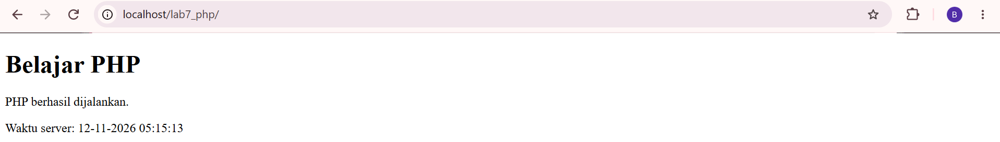

#### 2. Latihan 2 — Variabel, Operator, dan Percabangan
Menghitung nilai akhir mahasiswa berdasarkan bobot komponen tugas (30%), UTS (30%), dan UAS (40%), kemudian menentukan predikat huruf menggunakan struktur percabangan if-elseif-else.

* *Pengujian Nilai Predikat A:*
  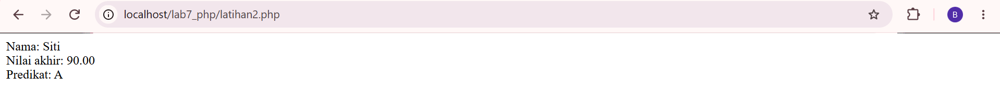

* *Pengujian Nilai Predikat C:*
  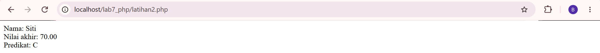 

#### 3. Latihan 3 — Perulangan dan Array
Menyimpan daftar nama mahasiswa ke dalam tipe data array (dengan penambahan minimal tiga nama baru) dan menampilkannya secara dinamis dalam bentuk daftar berurut menggunakan perulangan foreach.

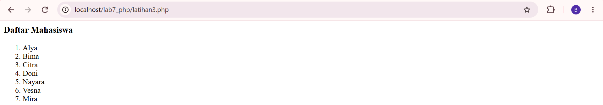

#### 4. Latihan 4 — Membuat Function
Membuat function hitungDiskon() untuk menghitung potongan harga barang serta menambahkan function tambahan untuk menghitung luas persegi panjang maupun menentukan kelulusan berdasarkan nilai agar kode lebih modular.

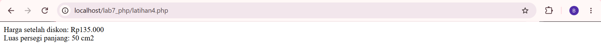

---

### Tahap 2: Pemrosesan Form (GET & POST) dan Pengolahan Data
Tahap ini berfokus pada bagaimana PHP menerima, memvalidasi, mengamankan, dan mengolah data yang dikirimkan pengguna melalui form HTML.

#### 5. Latihan 5 — Memproses Form dengan GET
Membuat form pencarian kata kunci menggunakan metode GET sehingga parameter input terlihat langsung pada URL browser, serta mengamankan output dengan htmlspecialchars().

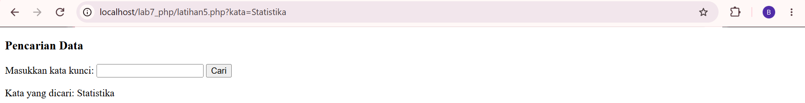

#### 6. Latihan 6 — Memproses Form dengan POST
Membuat form input Nama dan Program Studi menggunakan metode POST disertai validasi kolom kosong di sisi server dan sanitasi karakter khusus HTML.

* *Pengujian Input Data Valid:*
  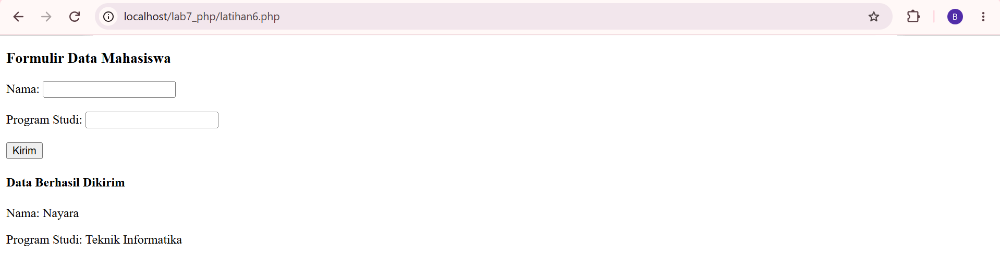

* *Pengujian Input Kosong:*
  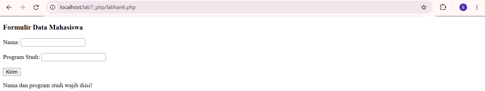

* *Pengujian Input Karakter Kutip dan Tag HTML (Keamanan XSS):*
  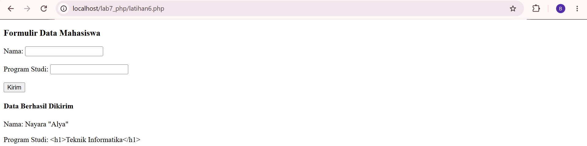

#### 7. Latihan 7 — Pengolahan Data Sederhana
Membangun form transaksi sederhana (nama barang, harga, dan jumlah) dengan validasi tipe data numerik dan bilangan bulat positif di sisi server sebelum menghitung subtotal transaksi.

* *Pengujian Data Transaksi Valid:*
  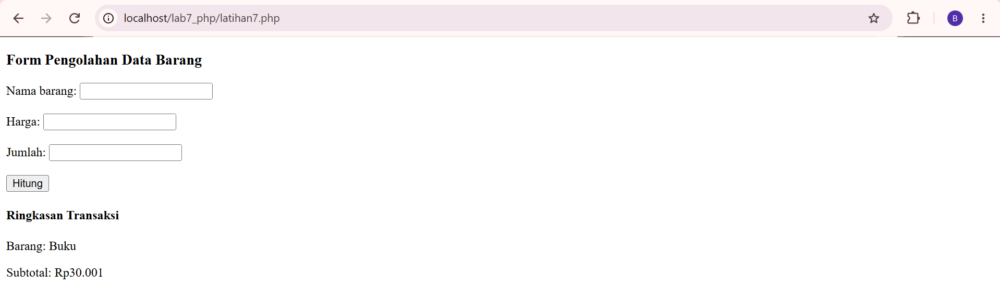

* *Pengujian Data Tidak Sesuai / Negatif / Nol:*
  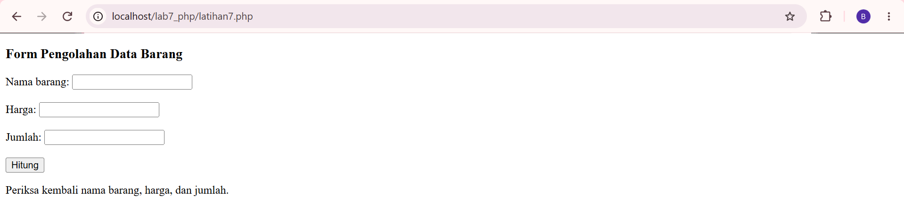

---

## Mini Project — Aplikasi Formulir Data Mahasiswa

Membangun aplikasi formulir pendaftaran mahasiswa menggunakan metode POST yang memisahkan logika pemrosesan PHP dari tampilan HTML. Aplikasi ini menerapkan validasi server-side untuk memastikan seluruh kolom terisi, format email sesuai standar (FILTER_VALIDATE_EMAIL), dan semester berupa bilangan bulat antara 1–14.

* *Pengujian Input Formulir Valid (Menampilkan Ringkasan Data):*
  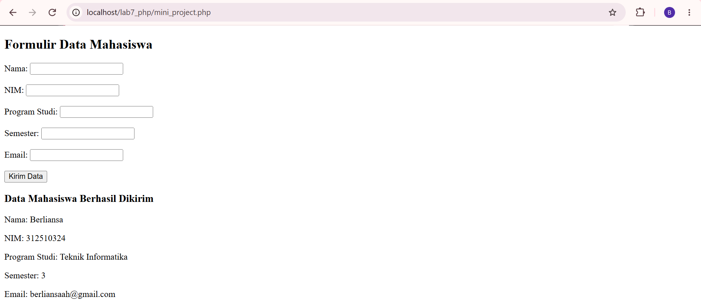

* *Pengujian Input Formulir Tidak Valid (Menampilkan Pesan Kesalahan):*
  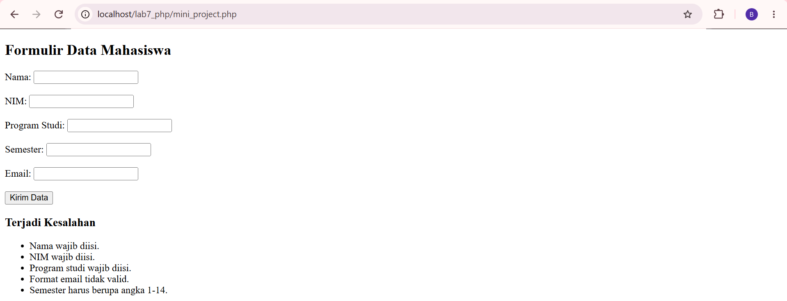

---

## Eksperimen Mandiri

Sebagai pengembangan dari materi modul, dilakukan lima percobaan mandiri untuk memperdalam pemahaman pemrograman PHP:

#### 1. Eksperimen 1: Perhitungan Nilai Rata-Rata
Menambahkan logika perhitungan nilai rata-rata dari tiga komponen nilai yang diinputkan.

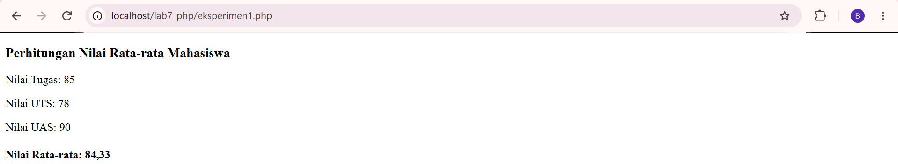

#### 2. Eksperimen 2: Pencarian Nama pada Array dengan Metode GET
Memodifikasi fitur pencarian GET agar dapat mencari dan mencocokkan nama mahasiswa dari sekumpulan data array sederhana.

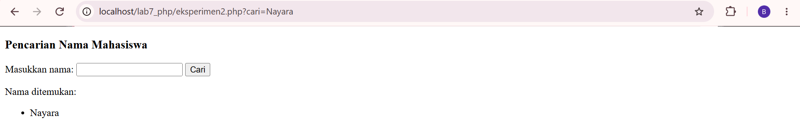

#### 3. Eksperimen 3: Function Format Harga Rupiah
Membuat function khusus menggunakan number_format() untuk mengubah angka nominal menjadi format mata uang Rupiah yang rapi.

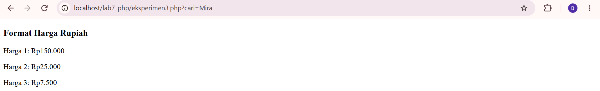

#### 4. Eksperimen 4: Validasi Format dan Panjang NIM
Menambahkan aturan validasi server-side agar input NIM hanya menerima karakter angka (ctype_digit) dengan panjang digit yang telah ditentukan.

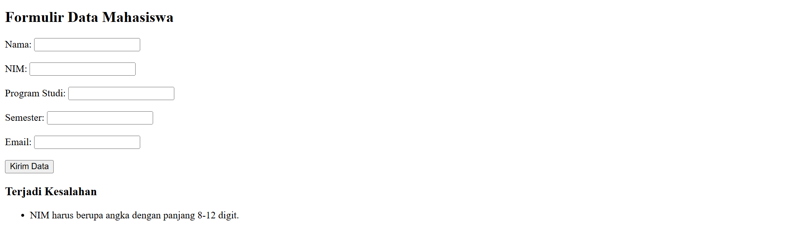

#### 5. Eksperimen 5: Tombol Reset Form vs Pemrosesan Ulang di Server
Menambahkan tombol reset pada form HTML. Perbedaannya dengan pemrosesan ulang di server adalah tombol reset hanya bekerja di sisi client (browser) untuk mengembalikan nilai input ke kondisi awal tanpa mengirim permintaan HTTP baru ke server, sedangkan pemrosesan ulang di server memuat ulang halaman dan mengeksekusi ulang skrip PHP dari awal.

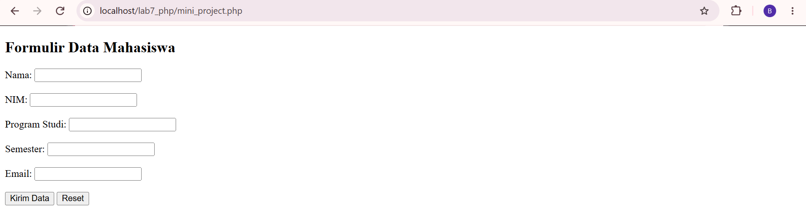

---

## Jawaban Pertanyaan Evaluasi

#### 1. Apa perbedaan pemrosesan client-side dan server-side?
Jawaban: Client-side adalah pemrosesan yang dilakukan di browser pengguna, sedangkan server-side dilakukan di server menggunakan bahasa seperti PHP.

#### 2. Mengapa file PHP harus dijalankan melalui web server?
Jawaban: Karena PHP merupakan bahasa pemrograman server-side yang harus diproses oleh server sebelum hasilnya dikirimkan ke browser.

#### 3. Apa fungsi tanda $ pada variabel PHP?
Jawaban: Tanda $ digunakan untuk menandai variabel dalam PHP, misalnya $nama dan $harga.

#### 4. Apa perbedaan metode GET dan POST?
Jawaban: GET mengirim data melalui URL sehingga parameternya terlihat di alamat browser. POST mengirim data melalui isi permintaan HTTP sehingga tidak ditampilkan sebagai parameter URL.

#### 5. Mengapa input pengguna perlu divalidasi di sisi server?
Jawaban: Agar data yang diterima sesuai ketentuan dan tidak hanya bergantung pada pemeriksaan di browser.

#### 6. Apa fungsi htmlspecialchars() ketika menampilkan data dari form?
Jawaban: Mengubah karakter khusus HTML menjadi bentuk aman sehingga input pengguna tidak diproses sebagai kode HTML.

#### 7. Apa manfaat penggunaan function dalam program PHP?
Jawaban: Membuat kode lebih terstruktur, dapat digunakan berulang kali, dan mengurangi penulisan kode yang sama.

---

## Kesimpulan Praktikum
Melalui modul Praktikum 7 ini, saya memahami cara kerja eksekusi kode server-side menggunakan PHP melalui server lokal serta perbedaannya dengan pemrosesan client-side. Penerapan variabel, percabangan, perulangan, dan function mempermudah pengolahan logika aplikasi, sementara kombinasi metode POST, validasi server-side, dan fungsi htmlspecialchars() sangat penting untuk menjaga keakuratan serta keamanan data yang dikirimkan pengguna melalui form HTML.